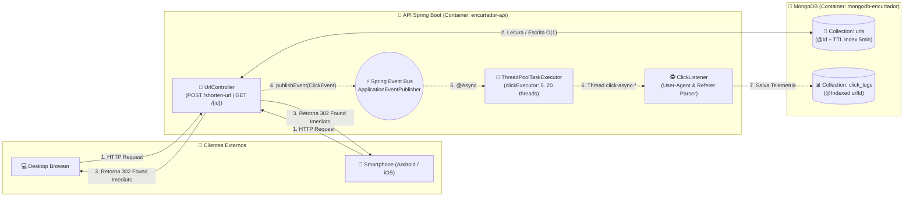
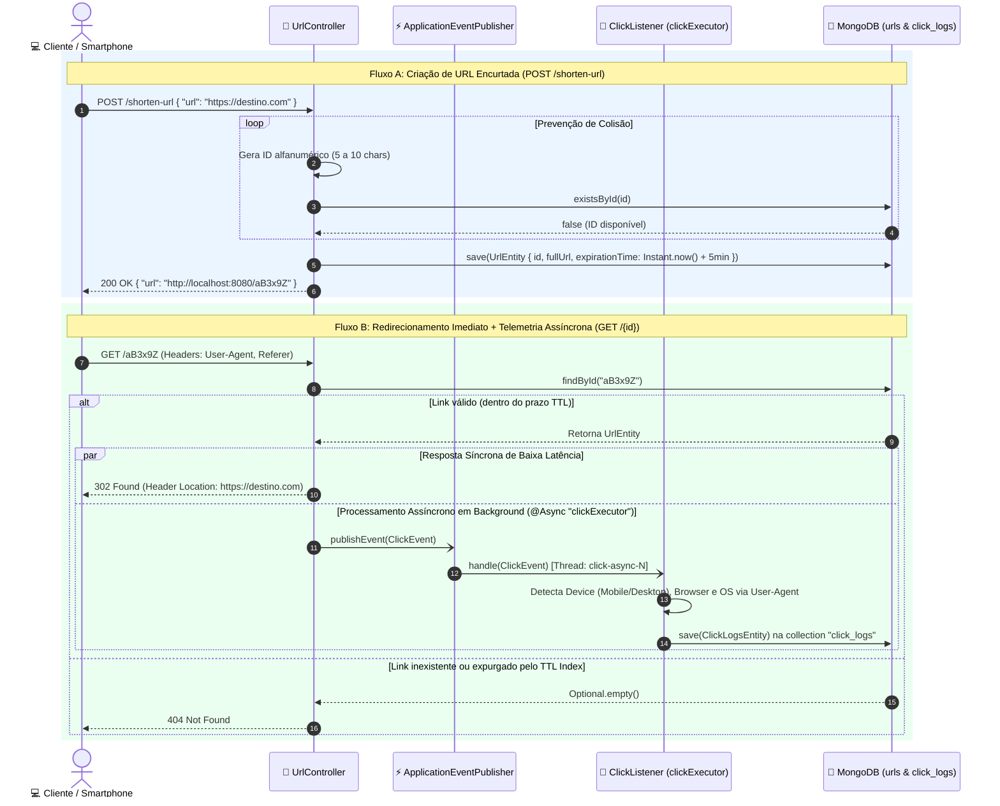
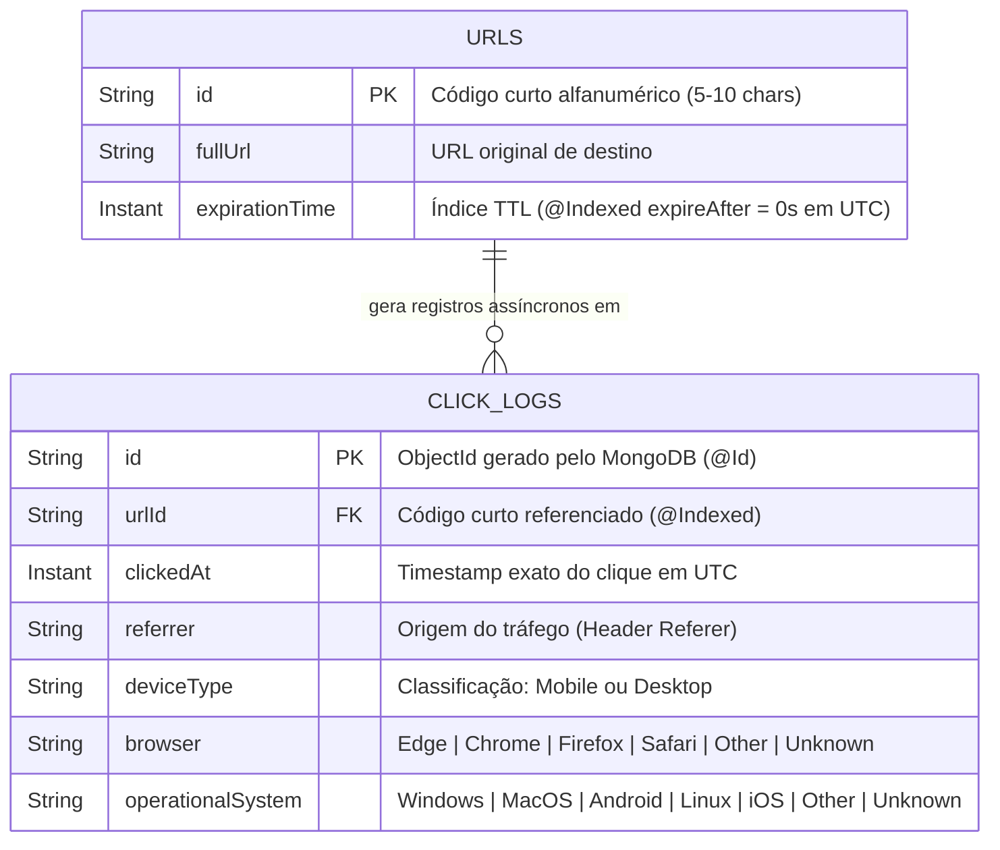

<div align="center">

# 🔗 Encurtador de URLs (`encurtador-url`)
### Redirecionamento de Alta Performance, Expiração Automática (TTL), Telemetria Assíncrona de Cliques & Persistência NoSQL com MongoDB

[](https://openjdk.org/)
[](https://spring.io/projects/spring-boot)
[](https://spring.io/projects/spring-data-mongodb)
[](https://www.mongodb.com/)
[](https://hub.docker.com/r/matheusrodrigues2007/encurtador-url-public-api)

<p align="center">
  <b>Serviço RESTful de encurtamento, redirecionamento de URLs e telemetria assíncrona de cliques construído com Java 21 e Spring Boot. Utiliza geração de identificadores alfanuméricos únicos com verificação de colisão, expiração nativa no banco de dados via índices TTL (Time-To-Live) do MongoDB em UTC, processamento de eventos em background com <code>ThreadPoolTaskExecutor</code> e infraestrutura 100% conteinerizada no Docker Hub e Docker Compose.</b>
</p>

</div>

---

## 📌 Visão Geral do Sistema

O **`encurtador-url`** é uma API backend projetada para resolver dois desafios centrais de sistemas encurtadores de links modernos: **redirecionamento HTTP de baixíssima latência** e **rastreamento analítico de cliques sem bloqueio de I/O**.

| Pilar do Sistema | Escopo Técnico | Implementação no Projeto |
| :--- | :--- | :--- |
| 🚀 **Core URL Shortener** | Geração de códigos curtos únicos, redirecionamento imediato e expurgo automático de links expirados | `POST /shorten-url`, `GET /{id}` (`302 Found`), prevenção de colisão no MongoDB e `@Indexed(expireAfter = "0s")` em UTC |
| ⚡ **Async Click Analytics** | Captura não-bloqueante de metadados de cada acesso em pool de threads dedicado | `@EnableAsync`, `ThreadPoolTaskExecutor` (`clickExecutor`), `ApplicationEventPublisher`, `@EventListener` e coleção `click_logs` |
| 🕵️ **User-Agent & Traffic Parser** | Identificação automática de origem do tráfego, dispositivo, navegador e sistema operacional | Extração dos headers `User-Agent` e `Referer`, classificando `Mobile`/`Desktop`, `Browser` e `OS` |
| 🐳 **Containerização & Cloud-Ready** | Empacotamento em imagem Docker otimizada e orquestração pronta para execução com um comando | Imagem oficial no Docker Hub (`matheusrodrigues2007/encurtador-url-public-api:latest`) + `docker-compose.yml` com `healthcheck` |

---

## 🧠 Decisões Arquiteturais

### 1. Por que MongoDB (NoSQL) e Índices TTL Nativos?
Sistemas encurtadores de URL exigem leitura rápida no momento do redirecionamento (`GET /{id}`) e gerenciamento enxuto de armazenamento para links temporários:

1. **Busca Direta por Chave Primária (`_id`):** O código alfanumérico gerado (de 5 a 10 caracteres) é gravado diretamente como a chave primária (`@Id`) do documento na coleção `urls`, garantindo buscas em complexidade `O(1)` / `O(log N)` via índice B-Tree nativo sem necessidade de *joins*.
2. **Expurgo Automático no SGBD (`TTL Index`):** Em vez de sobrecarregar a aplicação Java com *Cron Jobs* varrendo tabelas para remover links vencidos, utilizamos `@Indexed(expireAfter = "0s")` combinado com `java.time.Instant` (padrão UTC) e criação automática de índices (`spring.data.mongodb.auto-index-creation=true`). A própria *background thread* do MongoDB remove os documentos assim que o instante de expiração é atingido.
3. **Escrita Desacoplada de Alta Vazão (`click_logs`):** A modelagem orientada a documentos permite persistir eventos analíticos de cliques de forma independente e indexada pelo código da URL (`@Indexed` em `urlId`), evitando contenção ou bloqueios transacionais na coleção principal `urls`.

---

### 2. ⚡ Telemetria Assíncrona com `ThreadPoolTaskExecutor` & Spring Events
Em um encurtador de URLs de alta performance, **a gravação de métricas de acesso jamais deve atrasar o redirecionamento `GET /{id}` do usuário**. Se o cliente precisasse aguardar o parsing de cabeçalhos HTTP e um `INSERT` adicional no MongoDB antes de receber o `302 Found`, o tempo de resposta dobraria.

Para resolver isso, o sistema utiliza uma arquitetura **Orientada a Eventos e Não-Bloqueante**:

* **Desacoplamento com `ApplicationEventPublisher`:** Assim que o `UrlController` localiza a URL original no MongoDB, ele publica um evento imutável `ClickEvent` em memória e **retorna imediatamente** a resposta `302 Found` ao navegador.
* **Processamento em Background (`@Async("clickExecutor")` + `@EventListener`):** O componente `ClickListener` consome o `ClickEvent` em uma thread separada (`click-async-*`), inspeciona o cabeçalho `User-Agent` (identificando **Sistema Operacional**, **Navegador** e **Tipo de Dispositivo: Mobile vs. Desktop**) e o cabeçalho `Referer`, e persiste o registro na coleção `click_logs`.
* **Pool de Threads Dedicado e Resiliente (`AsyncConfig`):** Em vez de usar o executor padrão do Spring (que cria threads sem limite sob pico de tráfego), configuramos um `ThreadPoolTaskExecutor` customizado (`clickExecutor`):
  * **`corePoolSize = 5`:** Mantém 5 threads vivas prontas para processar cliques sem *cold start*.
  * **`maxPoolSize = 20`:** Escala até 20 threads simultâneas durante picos de tráfego.
  * **`queueCapacity = 500`:** Absorve rajadas de até 500 eventos na fila de espera antes de abrir novas threads.
  * **`CallerRunsPolicy` (Backpressure Seguro):** Caso o pool e a fila atinjam 100% de capacidade em um cenário extremo, a política `ThreadPoolExecutor.CallerRunsPolicy` garante que **nenhum clique seja perdido** (`RejectedExecutionException`), aplicando *backpressure* gracioso na thread chamadora.

---

## 🔄 Visualização do Funcionamento e Arquitetura

### 1. Arquitetura Geral do Sistema


### 2. Diagrama de Sequência: Encurtamento, Redirecionamento e Telemetria em Paralelo


### 3. Modelagem de Dados NoSQL (`urls` & `click_logs`)


---

## 📡 Especificação dos Endpoints (Porta `8080`)

| Método | Endpoint | Descrição | Status de Retorno |
| :---: | :--- | :--- | :---: |
| `POST` | `/shorten-url` | Recebe uma URL original e retorna a URL encurtada com expiração automática de 5 minutos | `200 OK` |
| `GET` | `/{id}` | Redireciona o cliente via cabeçalho `Location` e dispara em background o registro em `click_logs` | `302 Found` / `404 Not Found` |

### Exemplos de Payloads e Documentos Persistidos

#### 1. Encurtar uma URL (`POST /shorten-url`)
**Request Body:**
```json
{
  "url": "https://github.com/matheusrrtavares"
}
```

**Response (`200 OK`):**
```json
{
  "url": "http://localhost:8080/X7kP9mQ"
}
```

#### 2. Documento Persistido na Coleção `urls` (com TTL de 5 minutos)
```json
{
  "_id": "X7kP9mQ",
  "fullUrl": "https://github.com/matheusrrtavares",
  "expirationTime": "2026-11-06T03:05:00.120Z",
  "_class": "matheusrrt.encurtadorurl.entities.UrlEntity"
}
```

#### 3. Documento Persistido Assincronamente na Coleção `click_logs` (após `GET /X7kP9mQ`)
```json
{
  "_id": "67d1e8b49c8f1a2b3c4d5e6f",
  "urlId": "X7kP9mQ",
  "clickedAt": "2026-11-06T03:00:12.451Z",
  "referrer": "https://www.linkedin.com/",
  "deviceType": "Mobile",
  "browser": "Safari",
  "operationalSystem": "iOS",
  "_class": "matheusrrt.encurtadorurl.entities.ClickLogsEntity"
}
```

---

## 🧪 Como o Projeto Foi Testado (Validação Local e em Dispositivos Reais via Ngrok)

Para garantir que tanto o redirecionamento `302 Found` quanto o motor assíncrono de telemetria funcionassem em cenários reais de rede e hardware variados, a validação foi conduzida em duas frentes:

1. **Testes de Integração Local e Concorrência de Threads:**
   * Disparo de requisições de criação e acesso validando nos logs da aplicação a execução desacoplada nas threads do pool (`[click-async-1]`, `[click-async-2]`, etc.) sem bloquear a thread HTTP principal do Tomcat (`[nio-8080-exec-*]`).
   * Verificação do expurgo automático da coleção `urls` pelo motor TTL do MongoDB após a janela de expiração em UTC.
2. **Testes em Dispositivos Externos Reais com Túnel HTTP (`ngrok`):**
   * A porta `8080` do ambiente local foi exposta para a internet pública utilizando o **Ngrok** (`npx ngrok http 8080`).
   * Como o `UrlController` constrói a URL encurtada dinamicamente a partir do `HttpServletRequest`, os links gerados através do domínio público do Ngrok puderam ser abertos diretamente em **smartphones reais (Android e iOS via rede móvel 4G/5G)** e em **outros computadores**.
   * Cada acesso externo foi inspecionado no MongoDB (`click_logs`), comprovando a detecção fiel de `deviceType` (`Mobile` vs `Desktop`), `browser` (`Chrome`, `Safari`, `Edge`, `Firefox`), `operationalSystem` (`Android`, `iOS`, `Windows`, `MacOS`, `Linux`) e `referrer`.

---

## 🚀 Como Executar na Sua Máquina (Passo a Passo)

Você pode rodar o projeto de duas maneiras: **100% via Docker Compose** (sem precisar instalar Java ou Maven localmente, usando a imagem oficial publicada no Docker Hub) ou em **Modo de Desenvolvimento** (banco no Docker + API na sua IDE).

### Passo 1: Clonar o Repositório e Criar o Arquivo `.env`
```bash
git clone https://github.com/matheusrrtavares/encurtador-url.git
cd encurtador-url/docker
cp .env.example .env
```

O arquivo `docker/.env` define as credenciais utilizadas pelo MongoDB e pela API:
```dotenv
MONGO_USERNAME=admin
MONGO_PASSWORD=admin123
MONGO_HOST=localhost
MONGO_PORT=27017
MONGO_DATABASE=encurtadorurl
```

---

### Opção 1: Executar Tudo com Docker Compose (Recomendado — Zero Configuração)
O arquivo `docker/docker-compose.yml` orquestra o container do **MongoDB** (com `healthcheck` via `mongosh`) e o container da **API** a partir da imagem pública oficial `matheusrodrigues2007/encurtador-url-public-api:latest`:

```bash
cd docker
docker compose up -d
```

Verifique se os containers estão em execução e saudáveis:
```bash
docker compose ps
```
* **`mongodb-encurtador`:** Rodando na porta `27017` com persistência no volume `mongodb_data`.
* **`encurtador-api`:** Rodando na porta `8080` (inicia automaticamente após o MongoDB passar no `healthcheck`).

---

### Opção 2: Modo de Desenvolvimento (MongoDB no Docker + API via Maven/IDE)
Se você quiser modificar o código-fonte ou depurar pela sua IDE:

1. **Suba apenas o container do banco de dados MongoDB:**
   ```bash
   cd docker
   docker compose up -d mongodb
   ```
2. **Execute a aplicação Spring Boot localmente (Java 21):**
   Defina as variáveis de ambiente `MONGO_USERNAME=admin` e `MONGO_PASSWORD=admin123` no terminal ou na configuração de execução da sua IDE e rode:
   ```bash
   cd ../encurtadorurl
   ./mvnw clean spring-boot:run
   ```

---

### 🛠️ Testando na Prática (cURL, Navegador e Ngrok)

#### 1. Criar um link encurtado via terminal (`cURL`)
```bash
curl -X POST http://localhost:8080/shorten-url \
  -H "Content-Type: application/json" \
  -d '{"url": "https://github.com/matheusrrtavares"}'
```
**Resposta esperada:**
```json
{"url":"http://localhost:8080/aB3x9Z"}
```

#### 2. Testar o redirecionamento e registrar o clique
Abra a URL retornada (`http://localhost:8080/aB3x9Z`) no seu navegador ou execute:
```bash
curl -i http://localhost:8080/aB3x9Z
```

#### 3. Consultar os cliques registrados diretamente no MongoDB
```bash
docker exec -it mongodb-encurtador mongosh -u admin -p admin123 --authenticationDatabase admin --eval "use encurtadorurl; db.click_logs.find().pretty()"
```

#### 4. (Opcional) Expor com Ngrok para testar pelo seu Smartphone
Caso queira testar acessos vindos do seu celular ou compartilhar o link com outros dispositivos:
```bash
npx ngrok http 8080
```
Basta usar a URL HTTPS gerada pelo Ngrok (ex.: `https://xxxx.ngrok-free.app/shorten-url`) para encurtar o link e abri-lo diretamente no celular!

---

[](https://www.linkedin.com/in/matheusrrtavares)
