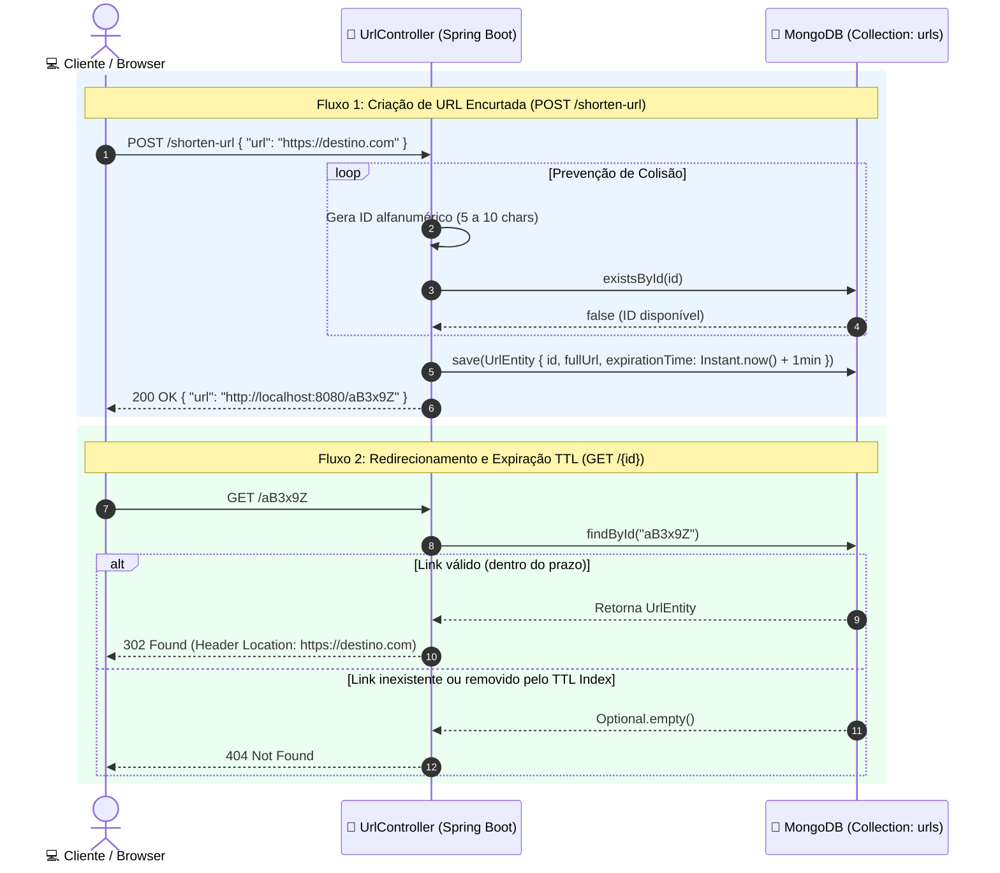
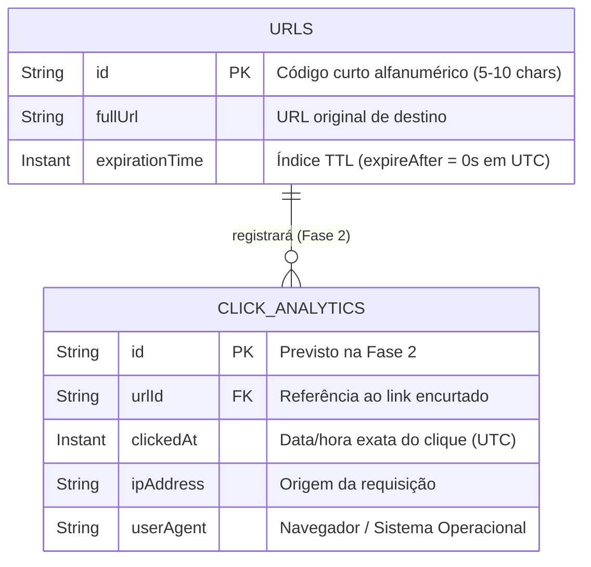

<div align="center">

# 🔗 Encurtador de URLs (`encurtador-url`)
### Redirecionamento de Alta Performance, Expiração Automática (TTL) & Persistência NoSQL com MongoDB

[](https://openjdk.org/)
[](https://spring.io/projects/spring-boot)
[](https://spring.io/projects/spring-data-mongodb)
[](https://www.mongodb.com/)
[](https://www.docker.com/)
[-Conclu%C3%ADda-2ea44f?style=for-the-badge)](#)

<p align="center">
  <b>Serviço RESTful de encurtamento e redirecionamento de URLs construído com Java 21 e Spring Boot, utilizando geração de identificadores alfanuméricos únicos com verificação de colisão, expiração nativa no banco de dados via índices TTL (Time-To-Live) do MongoDB em UTC e infraestrutura conteinerizada com Docker Compose.</b>
</p>

</div>

---

## 🌐 Ciclo Evolutivo do Projeto (Roadmap de Engenharia)

> Este projeto foi concebido em **duas fases evolutivas**. A **Fase 1 (Core Engine)** encontra-se concluída e operacional; a **Fase 2 (Click Analytics)** está em desenvolvimento para acoplamento de telemetria de acessos:

| Fase do Projeto | Escopo Arquitetural | Principais Entregas Técnicas | Status |
| :--- | :--- | :--- | :---: |
| 🚀 **Fase 1 — Core URL Shortener** | Motor de encurtamento, resolução de colisões, redirecionamento HTTP `302` e expurgo automático por TTL | `POST /shorten-url`, `GET /{id}`, `@Indexed(expireAfter = "0s")` com `Instant` (UTC), Docker Compose com volumes e variáveis `.env` | ✅ **Concluída (Você está aqui)** |
| 📊 **Fase 2 — Click Analytics Engine** | Telemetria de cliques, rastreamento de tráfego e relatórios analíticos por link encurtado | Contagem atômica de cliques, captura de metadados (`Timestamp`, `IP`, `User-Agent` / `Referer`) e endpoint `GET /{id}/stats` | 🚧 **Em Desenvolvimento** |

---

## 🧠 Decisão Arquitetural: Por que MongoDB (NoSQL) e TTL Index?

Sistemas encurtadores de URL exigem **baixa latência de leitura** (no momento do redirecionamento `GET /{id}`) e gerenciamento eficiente de ciclo de vida para milhões de links temporários:

<<<<<<< HEAD
1. **Busca Direta por Chave Primária (`_id`):** O código alfanumérico gerado (de 5 a 10 caracteres) é armazenado diretamente como a chave primária (`@Id`) do documento na coleção `urls`, garantindo buscas em complexidade `O(1)` / `O(log N)` via índice B-Tree nativo sem necessidade de *joins*.
=======
1. **Busca Direta por Chave Primária (`_id`):** O código alfanumérico gerado (de 5 a 10 caracteres) é armazenado diretamente como a chave primária (`@Id`) do documento na coleção `urls`, garantindo buscas em complexidade $O(1)$ / $O(\log N)$ via índice B-Tree nativo sem necessidade de *joins*.
>>>>>>> ddff00a (README e .env.example)
2. **Expurgo Automático no SGBD (`TTL Index`):** Em vez de sobrecarregar a aplicação Java com *Cron Jobs* varrendo tabelas para deletar links vencidos, utilizamos `@Indexed(expireAfter = "0s")` combinado com `java.time.Instant` (padrão UTC). A própria *background thread* do MongoDB remove os documentos assim que o instante de expiração é atingido.
3. **Preparação para a Fase 2 (Analytics):** A modelagem orientada a documentos facilita a evolução do schema para armazenar eventos e métricas de cliques de alta vazão sem bloqueios transacionais pesados.

---

## ⚙️ Funcionalidades e Destaques de Engenharia (Fase 1)

* **Geração de Identificadores Alfanuméricos com Prevenção de Colisão:** Uso de `RandomStringUtils.randomAlphanumeric(5, 10)` (Apache Commons Lang 3) validado em malha com `urlRepository.existsById(id)` para garantir unicidade absoluta antes da persistência.
* **Redirecionamento HTTP Semântico (`302 Found`):** O endpoint `GET /{id}` injeta dinamicamente a URL de destino no cabeçalho HTTP `Location` e retorna o status `302 Found` (ou `404 Not Found` caso o link não exista ou já tenha sido expurgado pelo TTL).
* **Padronização Temporal em UTC (`java.time.Instant`):** Manipulação de datas de expiração com `Instant.now().plus(1, ChronoUnit.MINUTES)`, prevenindo discrepâncias de fuso horário entre a JVM e o motor TTL do container MongoDB.
* **Isolamento de Camadas com Java Records (DTOs):** Contratos de entrada e saída imutáveis utilizando `ShortenUrlRequest` e `ShortenUrlResponse`.
* **Segurança de Configuração (12-Factor App):** Credenciais de banco de dados externalizadas via variáveis de ambiente (`${MONGO_USERNAME}`, `${MONGO_PASSWORD}`) e arquivo `.env` isolado do controle de versão.

---

## 🔄 Fluxo de Execução e Modelo de Dados

### 1. Fluxo de Encurtamento e Redirecionamento


### 2. Modelagem de Dados (Atual + Evolução Fase 2)


---

## 📡 Endpoints da API (Porta 8080)

| Método | Endpoint | Descrição | Status de Retorno |
| :---: | :--- | :--- | :---: |
| `POST` | `/shorten-url` | Recebe uma URL original e retorna a URL encurtada com expiração automática | `200 OK` |
| `GET` | `/{id}` | Busca o código curto e redireciona o cliente via cabeçalho `Location` | `302 Found` / `404 Not Found` |
| `GET` | `/{id}/stats` | *(Em breve - Fase 2)* Retorna métricas de cliques e acessos do link | `🚧 Roadmap` |

### Exemplos de Requisição e Resposta

#### `POST /shorten-url`
**Request Body:**
```json
{
  "url": "https://github.com/matheusrrtavares"
}
```

**Response (`200 OK`):**
```json
{
  "url": "http://localhost:8080/X7kP9mQ"
}
```

---

## 🚀 Como Executar

### 1. Clonar o Repositório e Configurar Variáveis (`.env`)
```bash
git clone https://github.com/matheusrrtavares/encurtador-url.git
cd encurtador-url/docker
cp .env.example .env
```

Conteúdo padrão do arquivo `docker/.env`:
```dotenv
MONGO_USERNAME=admin
MONGO_PASSWORD=admin123
MONGO_HOST=localhost
MONGO_PORT=27017
MONGO_DATABASE=encurtadorurl
```

### 2. Subir o Banco de Dados MongoDB (Docker Compose)
```bash
docker compose up -d
```
*(O container `mongodb-encurtador` subirá na porta `27017` com persistência garantida pelo volume `mongodb_data`).*

### 3. Executar a Aplicação Spring Boot
Configure as variáveis `MONGO_USERNAME=admin` e `MONGO_PASSWORD=admin123` na sua IDE ou no terminal e execute:
```bash
cd ../encurtadorurl
./mvnw clean spring-boot:run
```

--- 

[](https://www.linkedin.com/in/matheusrrtavares)

---

## 👨‍💻 Autor

Desenvolvido por **Matheus Rodrigues Rocha Tavares**  
*Backend Java Developer | Software Engineering B.S.*  

[](https://www.linkedin.com/in/matheusrrtavares)
